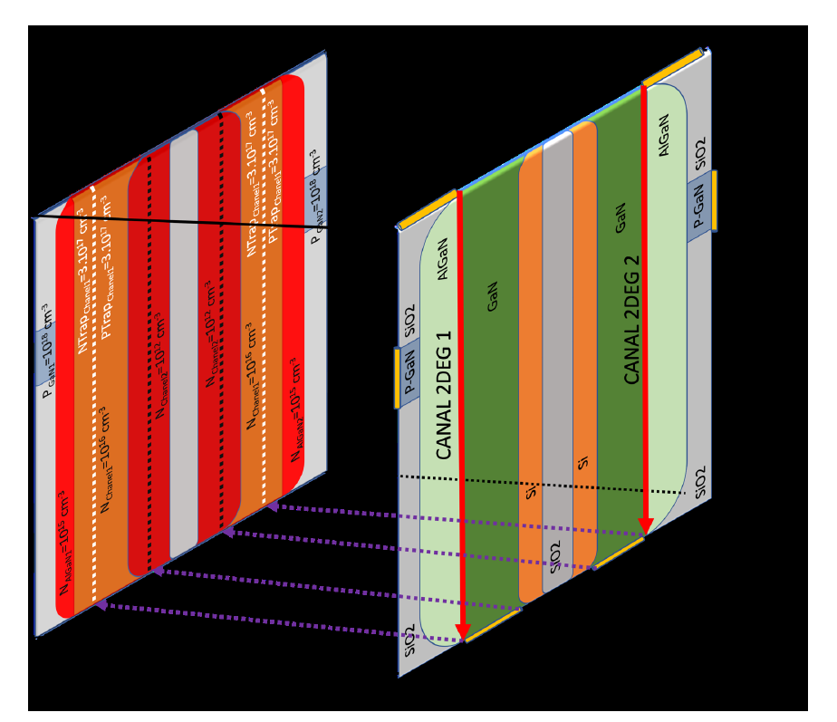
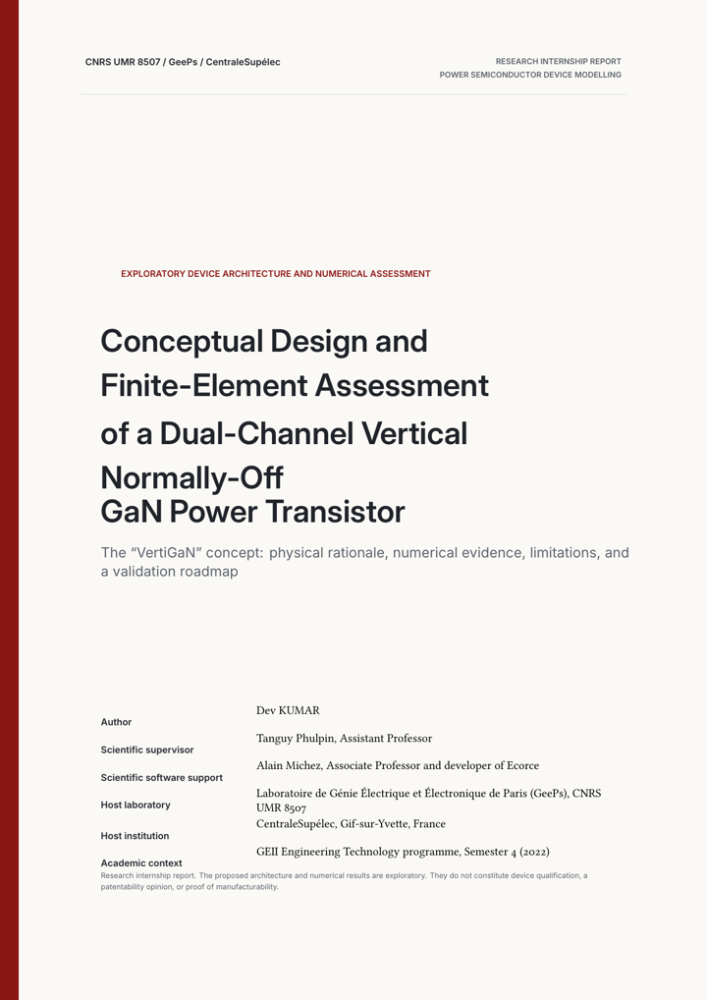
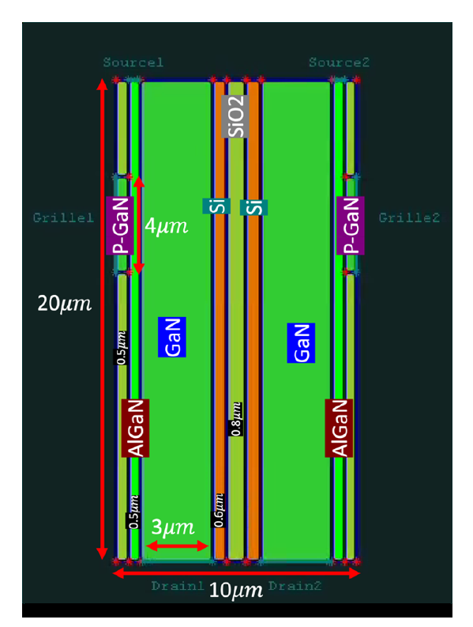
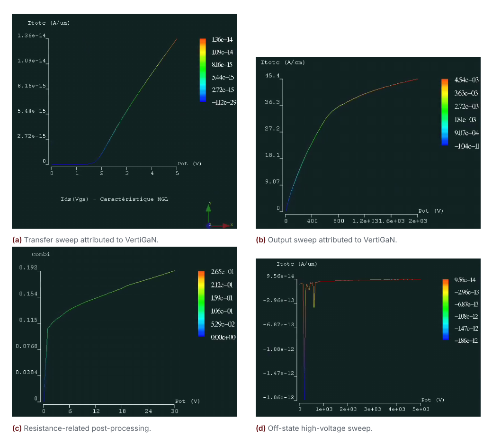

# VertiGaN - Exploratory Dual-Channel Vertical Normally-Off GaN Transistor

[](https://github.com/devkumar-projects/HeMT-GaN-Transistor/actions/workflows/tests.yml)
[](LICENSE)
[](#scientific-status)
[](#ecorce-access-and-installation)

**Conceptual design, semiconductor-physics analysis and finite-element assessment of a mirrored, six-terminal, vertical normally-off GaN power-transistor architecture.**

This repository curates a 2022 three-month research internship conducted at
GeePs (CNRS UMR 8507) / CentraleSupélec. The central question is whether
vertical voltage support can be combined with p-GaN-controlled enhancement-mode
channels without sacrificing current capability.

> **Scientific status:** VertiGaN is a credible and testable device hypothesis,
> not a qualified transistor specification. The available exported sweeps are
> exploratory and contain a major transfer/output inconsistency that must be
> resolved before performance claims are made.

<p align="center">
  
</p>

## Research report

The complete technical report is included here:

**[VertiGaN CNRS Research Internship Report (PDF)](report/VertiGaN_CNRS_Research_Internship_Report.pdf)**

<p align="center">
  <a href="report/VertiGaN_CNRS_Research_Internship_Report.pdf">
    
  </a>
</p>

## Research question

Can a mirrored vertical GaN architecture use polarization-assisted channels
and p-GaN gate control to obtain normally-off operation without sacrificing
the voltage scalability associated with a vertical drift region?

Lateral GaN HEMTs offer high mobility and low switching charge, but voltage
support depends on lateral access length and surface-field management. Vertical
devices move the blocking direction into the drift region, at the cost of drift
resistance, process complexity and more difficult enhancement-mode control.
VertiGaN attempts to decouple these constraints.

## Proposed architecture

The conceptual device contains two mirrored conduction cells separated by an
insulating central region. Each cell has:

- a source and drain;
- a gate-adjacent p-GaN control region;
- an AlGaN/GaN or GaN conduction path;
- a vertical drift direction;
- independent terminals, allowing parallel, differential or redundant biasing.

<p align="center">
  
</p>

The original 2-D implementation establishes topological connectivity, but it is
not a fabrication-ready mask set. Contact stacks, edge termination, exact
out-of-plane width, process tolerances and thermal boundaries remain open.

## Major numerical observations

<p align="center">
  
</p>

| Observation | Reported/exported value | Responsible interpretation |
|---|---:|---|
| Lateral GaN benchmark apparent turn-on | ~4.4 V | Qualitatively plausible gate modulation; extraction and width normalisation require documentation. |
| Lateral GaN displayed current | ~19.5 A/cm | Useful benchmark response, not a directly comparable device rating. |
| VertiGaN apparent transfer change | near 1.7 V | Current remains around `10^-14 A/cm`, near the numerical floor; **not a validated threshold**. |
| VertiGaN output endpoint | ~45.6 A/cm | Evidence of a high-current branch in one sweep; **not a saturation or rated current**. |
| Resistance-related post-processing | ~192 mΩ | Formula, terminal pair, active area and dimensional normalisation were not archived. |
| Off-state numerical floor | around `10^-13 A/cm` to a requested ~5 kV | No avalanche transition is visible, but impact ionisation was not demonstrated; **not a >5 kV breakdown rating**. |

The most important result is the contradiction between the near-floor transfer
current and the high-current output sweep under nominally related bias conditions.
Possible causes include terminal grouping, gate reference, implicit depth,
physics settings, saved-state initialisation, geometry revision or post-processing.

## What the study supports

- A mirrored six-terminal vertical GaN topology can be represented in a 2-D multiphysics solver.
- The benchmark set recovers recognisable lateral GaN, SiC MOSFET and vertical SiC JFET behaviour.
- One VertiGaN output sweep contains a high-current branch.
- The off-state result remains near the solver floor over the investigated bias interval.
- The architecture is distinct enough to justify a rigorous design-of-experiments and prior-art programme.

## What it does not yet prove

- a verified positive VertiGaN threshold voltage;
- avalanche breakdown above the maximum requested voltage;
- a comparable specific on-resistance;
- dynamic on-resistance, switching loss or gate charge;
- electrothermal stability and equal current sharing;
- gate/dielectric lifetime, manufacturability or long-term reliability;
- patentability or commercial superiority.

## Mathematical and physical foundations

### 1. Simulation as a conditional mapping

A device simulation is a conditional prediction:

$$
\mathcal{M}(\theta, b, \mathcal{P}, \mathcal{N}) \longrightarrow y,
$$

where `θ` contains geometry/material parameters, `b` is the bias vector,
`P` is the selected physics and `N` is the discretisation/solver configuration.
A strong result must remain stable to reasonable perturbations of all four.

### 2. Poisson equation

$$
\nabla \cdot (\varepsilon_s \nabla \phi)
= -q(p-n+N_D^+-N_A^-) - \rho_{fix} - \rho_{trap}.
$$

Fixed polarization and trapped charge are especially important at GaN
heterointerfaces and dielectric boundaries.

### 3. Drift-diffusion transport

$$
\mathbf{J}_n = q\mu_n n\mathbf{E} + qD_n\nabla n,
\qquad
\mathbf{J}_p = q\mu_p p\mathbf{E} - qD_p\nabla p,
$$

with `E = -∇φ`. In steady state:

$$
\nabla\cdot\mathbf{J}_n=q(R-G),\qquad
\nabla\cdot\mathbf{J}_p=-q(R-G).
$$

### 4. Quantum confinement and 2DEG formation

A self-consistent AlGaN/GaN description may couple Poisson's equation to:

$$
\left[-\frac{\hbar^2}{2}\frac{d}{dz}
\left(\frac{1}{m^*(z)}\frac{d}{dz}\right)+E_c(z)\right]\psi_i
=E_i\psi_i,
$$

iterated until:

$$
\left\|\phi^{(k+1)}-\phi^{(k)}\right\|_\infty < \varepsilon_{PS}.
$$

### 5. Enhancement-mode gate control

A simplified threshold shift caused by sheet charge is:

$$
\Delta V_{TH}\approx -\frac{Q_s}{C_g}.
$$

The same p-GaN charge that improves normally-off behaviour can increase channel
resistance and introduce trap- or temperature-dependent threshold drift.

### 6. Transconductance and threshold extraction

$$
g_m(V_{GS})=\left.\frac{\partial I_D}{\partial V_{GS}}\right|_{V_{DS}}.
$$

A threshold must use a stated constant-current or linear-extrapolation rule.
A necessary dynamic-range condition is:

$$
\frac{I_D(V_{GS}>V_{TH})}{I_{floor}} \gg 1.
$$

### 7. Two-dimensional normalisation

Ecorce commonly reports 2-D current per unit out-of-plane depth:

$$
I_D=I_D'W,
\qquad
R_{on,sp}=R_{on}A_{active}.
$$

Width, active area, parallel-cell count and contact contributions must be
explicit before comparing devices.

### 8. Conduction and switching loss

$$
P_{cond}\simeq I_{rms}^{2}R_{on},
$$

$$
P_{sw}\simeq \frac{1}{2}V_{DS}I_D(t_r+t_f)f_s
+Q_GV_{drv}f_s+E_{oss}f_s.
$$

Low static resistance alone does not guarantee the best converter performance.

### 9. Wide-band-gap voltage scaling

The ideal unipolar drift-region trend is:

$$
R_{on,sp}^{ideal}\propto
\frac{V_{BR}^{2}}{\varepsilon_s\mu_nE_{crit}^{3}}.
$$

GaN's high critical field is attractive, but contacts, interfaces, crowding,
traps and self-heating can dominate the ideal material advantage.

### 10. Reproducibility metrics

Current conservation:

$$
\varepsilon_I=\frac{|\sum_k I_k|}{\sum_k|I_k|}<\varepsilon_{I,max}.
$$

Mesh convergence for metric `m`:

$$
\delta_m=\frac{|m_{h/2}-m_h|}{|m_{h/2}|}<\varepsilon_m.
$$

## Repository contents

```text
HeMT-GaN-Transistor/
├── assets/figures/                # Curated report figures
├── data/                          # Placeholder and schema guidance for future exports
├── docs/
│   ├── ARCHIVE_CURATION.md        # Included/excluded archive files
│   ├── ECORCE_SETUP_AND_TESTING.md
│   └── SCIENTIFIC_ROADMAP.md
├── models/ecorce/lateral-gan-hemt/
│   ├── device.dev                 # Available 2-D AlGaN/GaN benchmark
│   ├── transfer_gate_0_to_5V.sti
│   └── model-manifest.json
├── report/                        # Full research report PDF
├── tests/                         # Parser and deck-consistency tests
├── tools/
│   ├── ecorce_deck.py             # Static Ecorce deck inspector
│   └── plot_iv.py                 # Optional CSV plotting utility
├── AUTHORS.md
├── CITATION.cff
├── LICENSE
├── NOTICE.md
└── README.md
```

## Archive curation

The private archive contained obsolete drafts, copied teaching documents,
radiation exercises, internet images and OS metadata. They were not blindly
published. See **[Archive curation decisions](docs/ARCHIVE_CURATION.md)**.

Most importantly, the complete VertiGaN and SiC benchmark decks were absent.
The retained `academic.eco` pair is a lateral AlGaN/GaN benchmark. The repository
does not fabricate missing models or raw results.

## Quick start without Ecorce

Python 3.10+ is sufficient for deck inspection and tests. No third-party package
is required.

```bash
git clone https://github.com/devkumar-projects/HeMT-GaN-Transistor.git
cd HeMT-GaN-Transistor

python3 tools/ecorce_deck.py models/ecorce/lateral-gan-hemt
python3 -m unittest discover -s tests -v
```

Expected summary:

```text
Ecorce format: 2.22
Dimension: dim_2
Contacts: Source, Gate, Drain, Substrate
Materials: AlGaN, GaN, Si
Validation OK
```

## Ecorce access and installation

Ecorce is **not bundled**. The internship documents describe it as an
experimental semiconductor TCAD/finite-volume simulator and give the legacy
address `http://www.ecorce.eu/`. Some trapping/detrapping functionality was
historically distributed under a private licence. The legacy public site was
not reachable when this repository was prepared in July 2026.

Obtain a legitimate compatible installer and any required licence from the
software author, laboratory or institution. The retained model declares Ecorce
format version **2.22**. Exact Ecorce runtime packages were not documented in
the archive, so this repository deliberately does not invent an `apt install`
list for the proprietary application.

Installation of the open repository tools is documented for Linux, macOS and
Windows in **[Ecorce setup and testing](docs/ECORCE_SETUP_AND_TESTING.md)**.

## Test the retained Ecorce model

The available stimulus performs this stationary transfer sweep:

| Terminal/setting | Value |
|---|---:|
| Source | 0 V |
| Drain | 1 V |
| Substrate | 0 V |
| Gate | 0 to 5 V, step 0.1 V |
| Temperature | 300 K |

In Ecorce, open `device.dev`, load the `.sti` stimulus, inspect the mesh, run
the solver, inspect the log, then export terminal current versus gate voltage.
Before interpretation, verify current conservation, mesh convergence, units,
contact sign conventions and out-of-plane depth.

## Optional result plotting

```bash
python3 -m venv .venv
source .venv/bin/activate
python3 -m pip install -r requirements-analysis.txt

python3 tools/plot_iv.py data/export.csv \
  --x gate_voltage_V \
  --y drain_current_A_per_cm \
  --output results/transfer_curve.png
```

## Innovation and future research

Priority developments include:

1. reconstructing one version-controlled six-terminal VertiGaN deck;
2. automated current-conservation, branch-symmetry and mesh-convergence checks;
3. calibrated polarization/quantum, trap, avalanche and electrothermal models;
4. Latin-hypercube or other space-filling design exploration;
5. Pareto optimisation of `VTH`, `Ron,sp`, `VBR`, `gm`, `QG`, peak field,
   maximum temperature and current-sharing symmetry;
6. field plates, edge termination and alternative central isolation;
7. differential, redundant or independently sensed six-terminal operation;
8. staged fabrication of contacts, MIS capacitors, p-GaN channels and vertical diodes.

The detailed programme is in **[Scientific and innovation roadmap](docs/SCIENTIFIC_ROADMAP.md)**.

## Research context

- **Author:** Dev Kumar
- **Scientific supervisor:** Tanguy Phulpin
- **Ecorce software support:** Alain Michez
- **Host laboratory:** GeePs, CNRS UMR 8507
- **Host institution:** CentraleSupélec
- **Academic context:** GEII Engineering Technology programme, Semester 4
- **Internship year:** 2022

## Citation

Use the metadata in [`CITATION.cff`](CITATION.cff) and cite the included report.

## Licence and third-party boundaries

Repository-authored code and documentation are released under the
**[MIT License](LICENSE)**. Ecorce itself, private plugins, institutional
material databases and excluded third-party documents are not covered.
Read **[NOTICE.md](NOTICE.md)** before redistributing model artifacts.

---

**Research-stage disclaimer:** the numerical values are exploratory outputs,
not component qualifications, safety ratings, fabrication guarantees,
patentability opinions or investment claims.


## Executable artifact audit on Kaggle

[Auditing GaN Simulation Decks with Python](https://www.kaggle.com/code/devkumarkaggle/auditing-gan-simulation-decks-with-python) executes the repository's dependency-free inspector on losslessly embedded copies of the public lateral HEMT device/stimulus files, verifies their SHA-256 digests and deliberately tests an unknown-contact failure. This CPU-only, offline notebook inspects inputs; it does not execute Ecorce or validate the proposed vertical device. The [Engineering Workbench](https://huggingface.co/spaces/devkumarhf/Engineering-Workbench) connects this project to the broader control, robotics and engineering work.
